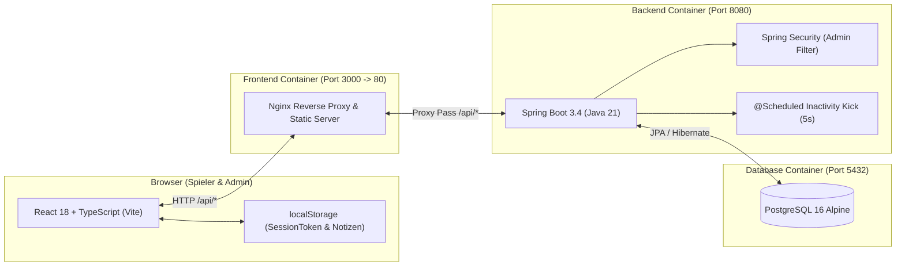
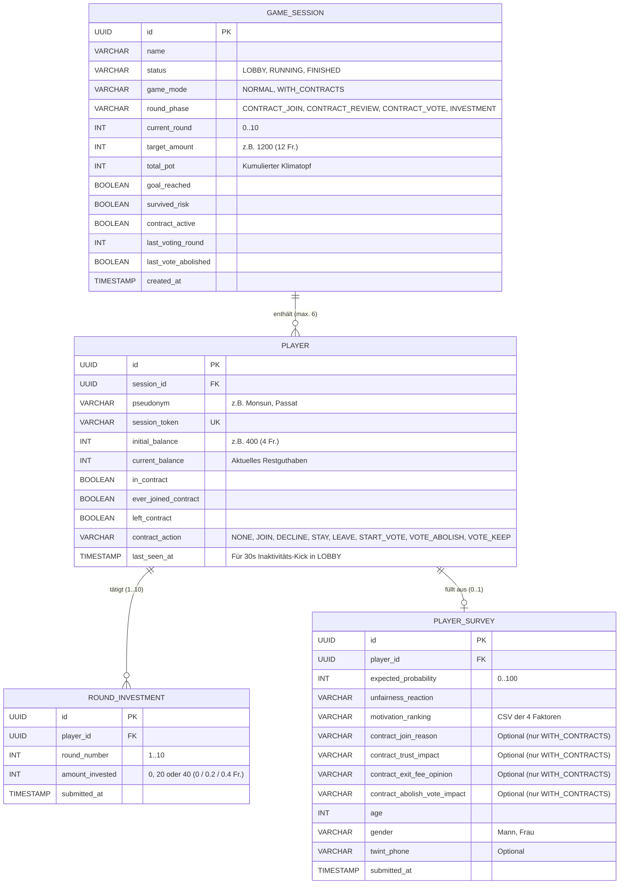
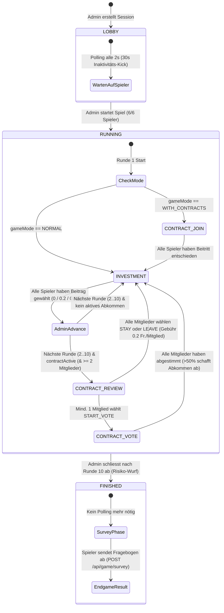

# Technischer Implementierungsplan: Collective-Risk Social Dilemma Experiment

Dieser Plan dokumentiert die technische Architektur, das Datenbankschema, die Zustandsmaschine, die REST-Schnittstellen sowie das Frontend-Design der Applikation.

---

## 1. Systemarchitektur & Technologie-Stack

Die Applikation ist als containerisierte Full-Stack-Anwendung aufgebaut und wird über `docker-compose.yml` orchestriert:

### Zentrale Konfiguration (`application.yml`)
Es gibt **keine** separate `AppProperties.java`-Klasse. Sämtliche Applikations- und Spielparameter werden zentral in [`backend/src/main/resources/application.yml`](backend/src/main/resources/application.yml) verwaltet und per `@Value` in die Spring-Komponenten injiziert:
* `app.admin-secret` (Umgebungsvariable `APP_ADMIN_SECRET`, Standard: `climategame2026`)
* `app.game.start-amount-chf` (`ENV_START_AMOUNT`, Standard: `4`)
* `app.game.group-size` (`ENV_GROUP_SIZE`, Standard: `6`)
* `app.game.total-rounds` (`ENV_TOTAL_ROUNDS`, Standard: `10`)
* `app.game.risk-level` (`ENV_RISK_LEVEL`, Standard: `0.90`)

---

## 2. Datenmodell & Datenbankschema (PostgreSQL)

Geldbeträge werden in der Datenbank als ganzzahlige **Rappen (`INTEGER`)** gespeichert (`400` = `4 Fr.`, `20` = `0.2 Fr.`), im Frontend jedoch durchgängig über [`currency.ts`](frontend/src/utils/currency.ts) in **Franken (`Fr.`)** formatiert.

---

## 3. Zustandsmaschine & Rundenphasen

Eine `GameSession` durchläuft die Zustände `LOBBY` $\rightarrow$ `RUNNING` $\rightarrow$ `FINISHED`. Es gibt keinen `PAUSED`-Zustand und keine Rundentimer; der Phasen- bzw. Rundenübergang erfolgt deterministisch anhand der Spieleraktionen und der manuellen Rundenfreigabe durch den Admin.

---

## 4. Backend-Komponenten & REST-API (`ch.bbw.climategame`)

### 4.1 Sicherheit & Hintergrundprozesse
* **[`SecurityConfig.java`](backend/src/main/java/ch/bbw/climategame/config/SecurityConfig.java) & [`AdminAuthenticationFilter.java`](backend/src/main/java/ch/bbw/climategame/config/AdminAuthenticationFilter.java):**
  Schützt alle `/api/admin/**`-Endpunkte über den HTTP-Header `X-Admin-Password`. Der Vergleich mit `app.admin-secret` erfolgt zeitkonstant via `MessageDigest.isEqual`.
* **Inaktivitäts-Bereinigung in [`GameService.java`](backend/src/main/java/ch/bbw/climategame/service/GameService.java):**
  Eine `@Scheduled(fixedRate = 5000)`-Methode (`cleanupInactiveLobbyPlayers`) sowie Aufrufe bei Lobby-Abfragen prüfen alle Spieler in `LOBBY`-Sessions. Ist `lastSeenAt` älter als **30 Sekunden**, wird der Spieler samt Abhängigkeiten aus der Session gelöscht.

### 4.2 Endpunkte für Spieler (`LobbyController` & `GameController`)
| Methode | Pfad | Beschreibung |
| :--- | :--- | :--- |
| `GET` | `/api/lobby/sessions` | Listet alle offenen `LOBBY`-Sessions inkl. aktueller Spieleranzahl und `gameMode`. |
| `POST` | `/api/lobby/join` | Tritt einer Session bei (oder stellt bestehende Sitzung via `sessionToken` wieder her). |
| `POST` | `/api/lobby/leave` | Entfernt den Spieler (`X-Session-Token`) sofort aus einer `LOBBY`-Session. |
| `GET` | `/api/game/state` | Liefert den vollständigen `GameStateResponse` für den Spieler und aktualisiert `lastSeenAt`. |
| `POST` | `/api/game/invest` | Speichert den Rundenbeitrag (`0`, `20` oder `40` Rappen) in der Phase `INVESTMENT`. Prüft Mindestbeitrag (`20`), falls `inContract == true`. |
| `POST` | `/api/game/contract/join` | Vor Runde 1 (`CONTRACT_JOIN`): Beitritt (`join: true/false`) zum Klimaabkommen. |
| `POST` | `/api/game/contract/review` | Zwischen zwei Runden (`CONTRACT_REVIEW`): Aktion `STAY`, `LEAVE` (inkl. Gebührenüberweisung von `20` Rappen an jedes verbleibende Mitglied) oder `START_VOTE`. |
| `POST` | `/api/game/contract/vote` | Abstimmung (`CONTRACT_VOTE`): `abolish: true/false`. Einfache Mehrheit (`> 50%`) löst das Abkommen kostenfrei auf. |
| `POST` | `/api/game/survey` | Speichert den Abschluss-Fragebogen (`PlayerSurvey`) nach Spielende (`FINISHED`). |

### 4.3 Endpunkte für Administratoren (`AdminController`)
| Methode | Pfad | Beschreibung |
| :--- | :--- | :--- |
| `GET` | `/api/admin/sessions` | Liefert alle Sessions inkl. Spieler-Readiness (`hasCompletedCurrentPhase`) für das Admin-Dashboard. |
| `POST` | `/api/admin/sessions` | Erstellt eine neue Session mit Name und `gameMode` (`NORMAL` oder `WITH_CONTRACTS`). |
| `POST` | `/api/admin/sessions/{id}/start` | Startet eine volle Session (`LOBBY` $\rightarrow$ `RUNNING`, Runde 1). |
| `POST` | `/api/admin/sessions/{id}/next-round` | Schaltet manuell in die nächste Runde weiter bzw. beendet das Spiel nach Runde 10 (`FINISHED`). |
| `DELETE` | `/api/admin/sessions/{id}` | Löscht eine Session inklusive aller Spieler, Investitionen und Fragebögen. |
| `GET` | `/api/admin/sessions/{id}/export.csv` | Generiert den UTF-8-BOM CSV-Export aller Spieldaten, Vertragsdaten und Fragebogen-Antworten. |

---

## 5. Frontend-Architektur (`frontend/src`)

### 5.1 State Management & Polling (`GameContext.tsx`)
* Verwaltet `sessionToken`, `gameState` und das `localSurveyCompleted`-Flag.
* **Gezieltes Polling:** Das 2-Sekunden-Polling (`GET /api/game/state`) ist **nur** aktiv, solange sich die Session im Status `LOBBY` oder `RUNNING` befindet. Im Login-Screen, im Fragebogen (`SurveyPage`) und auf dem Ergebnis-Screen (`EndgamePage`) findet kein Polling statt.
* Sobald der Spieler im Status `FINISHED` den Fragebogen absendet, setzt der Context `localSurveyCompleted = true` und wechselt ohne Seiten-Reload direkt zur `EndgamePage`.

### 5.2 Seiten & Komponenten
* **[`LobbyPage.tsx`](frontend/src/pages/LobbyPage.tsx):** Auswahl offener Sitzungen (mit Kennzeichnung von Variante 1 vs. Variante 2) sowie Warteraum mit direktem `"Raum verlassen"`-Button.
* **[`GamePage.tsx`](frontend/src/pages/GamePage.tsx):**
  * **Header:** Zeigt Sitzungsname, eigenes Pseudonym, Runde, Klimaziel (`12 Fr.`) und Restguthaben (`Fr.`).
  * **Aktuelle Aktions-Card (`#FCE8E4`):** Rendert phasengesteuert den Beitritt zum Abkommen (`CONTRACT_JOIN`), die Vertragsprüfung (`CONTRACT_REVIEW`), die Abschaffungsabstimmung (`CONTRACT_VOTE`) oder [`InvestmentControls.tsx`](frontend/src/components/player/InvestmentControls.tsx) (`INVESTMENT`).
  * **Kompakte Abkommens-Box & 10s-Toast:** Rote Statusbox über den Beitragsbuttons informiert über den eigenen Vertragsstatus; Ergebnisse einer Abschaffungsabstimmung werden für 10 Sekunden eingeblendet und danach automatisch ausgeblendet.
  * **[`HistoryTable.tsx`](frontend/src/components/player/HistoryTable.tsx):** Zeigt während des Spiels ausschliesslich die letzte abgeschlossene Runde (`completedRounds.slice(-1)`) ohne Gesamttopf-Summe.
  * **[`PlayerStatusList.tsx`](frontend/src/components/player/PlayerStatusList.tsx):** Unterste Card mit Gruppenstatus und Vertrags-Badges.
  * **[`LocalNotepad.tsx`](frontend/src/components/player/LocalNotepad.tsx):** Schlichter lokaler Notizblock (`localStorage`) ohne ablenkende Zusatzboxen.
* **[`SurveyPage.tsx`](frontend/src/pages/SurveyPage.tsx):** Mehrteiliger Fragebogen mit Slider (`0–100%`), Radio-Buttons, Drag-and-Drop-Ranking (HTML5 Drag & Drop + Pfeil-Buttons für Touch-Geräte), konditionalen Abkommens-Fragen bei `WITH_CONTRACTS` sowie Demografie (`Alter`, `Geschlecht: Mann / Frau`, `Twint`).
* **[`EndgamePage.tsx`](frontend/src/pages/EndgamePage.tsx):** Abschluss-Screen mit Klimatopf-Endstand, Risiko-Ausgang, persönlicher Auszahlung in `Fr.` und kompletter 10-Runden-Historie.
* **[`AdminPage.tsx`](frontend/src/pages/AdminPage.tsx):** Passwortgeschütztes Dashboard zur Erstellung, Überwachung, manuellen Rundenweiterschaltung und zum CSV-Export von Sessions.

### 5.3 Design Tokens (`tokens.css` & `main.css`)
* **Farbschema:** `#F5EBDD` (Cream Background), `#F2765E` (Coral Primary), `#315B8C` (Steel Blue Secondary/Focus), `#413333` (Espresso Ink/Borders).
* **Kantige UI-Geometrie:** Reduzierte Border-Radien (`2px` bis `4px`), klare `1px`–`2px` Rahmenlinien und tabellarische Ziffern (`font-variant-numeric: tabular-nums`) für alle Franken-Beträge.
