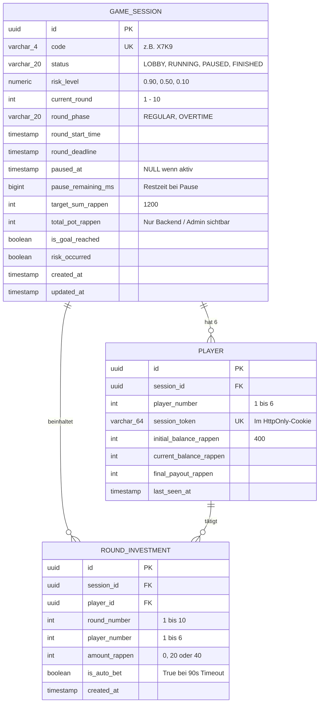
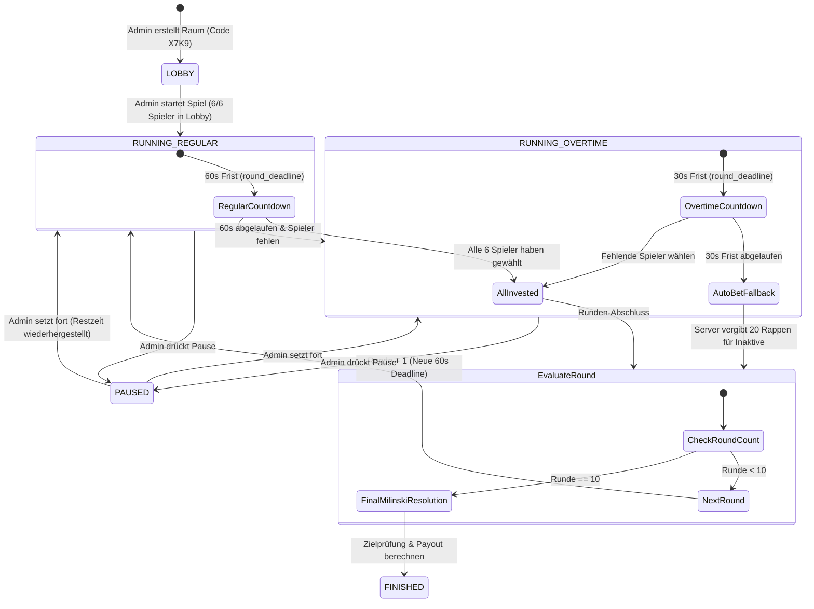
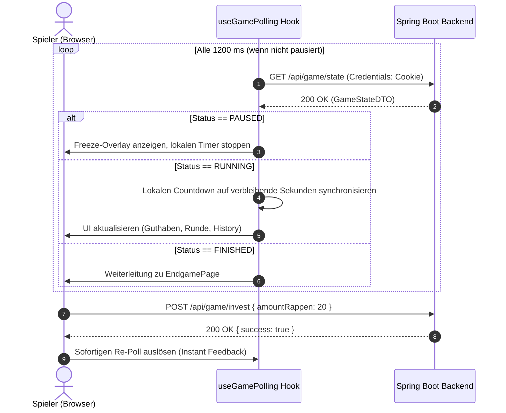
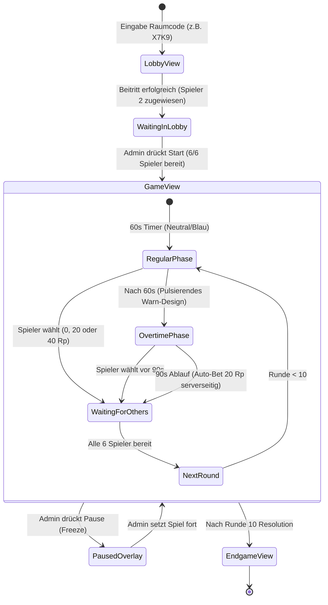

# Technischer Implementierungsplan: Milinski Collective-Risk Game

Dieses Dokument definiert die technische Architektur, Datenmodelle, API-Endpunkte und Systemabläufe für die Replikation des Milinski-Experiments basierend auf [spec.md](spec.md).

---

## 1. Technologiestack-Übersicht

* **Backend:** Java 21 LTS, Spring Boot 3.x (Spring Web, Spring Data JPA, Spring Validation)
* **Datenbank:** PostgreSQL 16 (als Service in `docker-compose.yml`)
* **Frontend:** React 18+ mit TypeScript (Vite-Build)
* **Kommunikation:** HTTP REST mit Polling (Intervall: 1000–1500 ms)
* **Infrastruktur & Deployment:** Docker Compose (`backend`, `frontend`, `postgres`)

---

## 2. Backend-Architektur (Java / Spring Boot 3)

### 2.1 Projektstruktur & Paket-Design
Klassische, saubere Spring Boot 3 Schichtenarchitektur (Separation of Concerns):

```
ch.bbw.climategame
├── config/              # WebMvcConfig, Security/CORS, SchedulingConfig
├── controller/          # REST-Controller (LobbyController, GameController, AdminController)
├── dto/                 # Request- & Response-Objekte (immutability via Java Records)
│   ├── request/         # JoinLobbyRequest, InvestRequest, CreateSessionRequest
│   └── response/        # GameStateResponse, AdminSessionResponse, PlayerStateDto
├── entity/              # JPA-Entities (GameSession, Player, RoundInvestment)
├── repository/          # Spring Data JPA Repositories
├── service/             # Geschäftslogik & State Machine (GameEngineService, AdminService, PayoutService)
└── scheduler/           # Periodischer Tick-Service für Deadlines und Auto-Bet
```

---

### 2.2 Relationales Datenmodell & Schema (PostgreSQL)



#### Rundungssicherheit:
* **Ganzzahlige Beträge in Rappen:** Alle Geldwerte (`balance`, `investment`, `target_sum`) werden in PostgreSQL als `INTEGER` in **Rappen** gespeichert (z. B. `400` Rappen = 4.00 CHF). Dadurch werden Rundungsfehler bei Floating-Point-Operationen zu 100% eliminiert.

---

### 2.3 Server-Authoritative State Machine & Timer-Logik



#### Timer-Architektur mit Spring Boot:
1. **Kein driftendes Tick-Zählen:** Stattdessen werden exakte Zeitstempel (`Instant.now()`) verwendet.
   * Rundenstart: `roundDeadline = Instant.now().plusSeconds(60)` (`REGULAR`).
   * Nach 60s: `roundPhase = OVERTIME`, `roundDeadline = Instant.now().plusSeconds(30)`.
2. **Hintergrund-Tick (`@Scheduled(fixedRate = 1000)`):**
   * Ein Spring-Scheduler prüft einmal pro Sekunde aktive Spiele:
     * Wenn `phase == REGULAR` und `Instant.now().isAfter(roundDeadline)`: Phasenwechsel zu `OVERTIME` (+30s).
     * Wenn `phase == OVERTIME` und `Instant.now().isAfter(roundDeadline)`: Ausführung von **Auto-Bet** (20 Rappen) für alle Spieler ohne Einsatz in dieser Runde. Runden-Evaluation wird ausgelöst.
3. **Freeze- / Pause-Verhalten (Spec 4.1):**
   * **Pause:** `pausedAt = Instant.now()`, `pauseRemainingMs = Duration.between(Instant.now(), roundDeadline).toMillis()`. Status wechselt zu `PAUSED`.
   * **Resume:** `roundDeadline = Instant.now().plusMillis(pauseRemainingMs)`, `pausedAt = null`. Status wechselt zurück zu `RUNNING`.
   * Das Polling liefert `is_paused: true` und `remaining_seconds`, sodass Clients das Freeze-Overlay sofort anzeigen und ihren lokalen Countdown stoppen.

---

### 2.4 REST-API-Spezifikation (Controller & Endpoints)

#### 2.4.1 Spieler-Endpunkte (`/api/player/...` bzw. `/api/game/...`)

* **`POST /api/lobby/join`**
  * **Payload:** `{ "code": "X7K9" }`
  * **Logik:**
    * Validiert Session-Status (`LOBBY`).
    * Vergibt die nächste freie `player_number` (1 bis 6).
    * Generiert kryptographischen `session_token` (UUID v4).
    * Setzt ein `HttpOnly`, `SameSite=Lax` Cookie: `CLIMATE_PLAYER_TOKEN=...`.
  * **Response:** `{ "sessionId": "...", "playerNumber": 2, "sessionToken": "..." }`

* **`GET /api/game/state`**
  * **Auth:** Liest `CLIMATE_PLAYER_TOKEN` aus Cookie oder Bearer-Header.
  * **Wichtig (Spec 1.4):** Liefert **keinen** Gesamttopf und **keinen** Fortschrittsbalken!
  * **Response-Struktur:**
    ```json
    {
      "status": "RUNNING",
      "currentRound": 3,
      "totalRounds": 10,
      "roundPhase": "REGULAR",
      "remainingSeconds": 38,
      "isPaused": false,
      "player": {
        "playerNumber": 2,
        "currentBalanceRappen": 360,
        "hasSubmittedCurrentRound": false,
        "allowedInvestmentOptions": [0, 20, 40]
      },
      "playersStatus": [
        { "playerNumber": 1, "isReady": true },
        { "playerNumber": 2, "isReady": false },
        { "playerNumber": 3, "isReady": true },
        { "playerNumber": 4, "isReady": false },
        { "playerNumber": 5, "isReady": false },
        { "playerNumber": 6, "isReady": true }
      ],
      "history": [
        {
          "round": 1,
          "investments": [
            { "playerNumber": 1, "amountRappen": 20 },
            { "playerNumber": 2, "amountRappen": 20 },
            { "playerNumber": 3, "amountRappen": 40 },
            { "playerNumber": 4, "amountRappen": 0 },
            { "playerNumber": 5, "amountRappen": 20 },
            { "playerNumber": 6, "amountRappen": 20 }
          ]
        }
      ]
    }
    ```

* **`POST /api/game/invest`**
  * **Auth:** Player Cookie / Token.
  * **Payload:** `{ "amountRappen": 20 }` (nur `0`, `20`, `40` erlaubt).
  * **Validierung:** Prüft, ob Spieler in dieser Runde bereits gesetzt hat und ob `currentBalanceRappen >= amountRappen`.
  * **Logik:** Speichert `RoundInvestment`. Wenn alle 6 Spieler gesetzt haben, rückt die Runde sofort vor.

---

#### 2.4.2 Admin-Endpunkte (`/api/admin/...`)
*Alle Admin-Endpunkte sind über den HTTP-Header `X-Admin-Key` (konfiguriert via `APP_ADMIN_SECRET`) abgesichert.*

* **`POST /api/admin/sessions`**
  * Erstellt neue Session mit Treatment (`riskLevel`: `0.90`, `0.50` oder `0.10`).
  * Generiert 4-stelligen Raumcode (z. B. `X7K9`, ohne leicht verwechselbare Zeichen wie `0`/`O`, `1`/`I`).

* **`GET /api/admin/sessions`** & **`GET /api/admin/sessions/{id}`**
  * Gibt dem Versuchsleiter vollen Einblick: alle 6 Spieler, deren Bereitschaftsstatus, Guthaben, Timer, Pause-Status und Gesamtsumme des Klimakontos.

* **`POST /api/admin/sessions/{id}/start`**
  * Startet das Spiel aus der Lobby (sobald 6/6 Spieler verbunden sind).

* **`POST /api/admin/sessions/{id}/pause`** & **`POST /api/admin/sessions/{id}/resume`**
  * Friert das Spiel serverseitig ein oder setzt es nahtlos fort.

* **`GET /api/admin/sessions/{id}/export.csv`**
  * Generiert und streamt die Auswertungs-CSV für die BMA-Arbeit.

---

### 2.5 Endgame-Resolution & Zufallsgenerator (Spec 1.3 & 6)

Nach Runde 10 führt `PayoutService` die Abrechnung durch:
1. `totalInvestments = sum(all investments)`
2. `goalReached = totalInvestments >= targetSumRappen` (>= 1200 Rappen)
3. **Wenn Ziel erreicht:**
   * `finalPayout = startBalance - ownInvestments`
   * Meldung: *"Klimaziel erreicht! Ihr Restguthaben wird ausbezahlt."*
4. **Wenn Ziel verfehlt:**
   * Auslosung via `java.security.SecureRandom`:
     ```java
     SecureRandom random = new SecureRandom();
     double roll = random.nextDouble(); // 0.0 bis 1.0
     boolean riskOccurred = roll < session.getRiskLevel().doubleValue();
     ```
   * **Risiko tritt NICHT ein (`riskOccurred == false`):**
     * `finalPayout = startBalance - ownInvestments`
     * Meldung: *"Ziel verfehlt. Sie hatten Glück: Ihr Restguthaben bleibt erhalten."*
   * **Risiko tritt EIN (`riskOccurred == true`):**
     * `finalPayout = 0`
     * Meldung: *"Ziel verfehlt. Ihr Geld ging durch das [X]% Risiko verloren. Auszahlung: 0 Rappen."*

---

### 2.6 BMA-CSV-Export-Format (Spec 4.3)
Format beim Aufruf von `/api/admin/sessions/{id}/export.csv`:
```csv
session_id,session_code,risk_treatment,target_sum_rappen,total_invested_rappen,target_reached,risk_occurred,round,player_number,invested_rappen,is_auto_bet,submitted_at,final_payout_rappen
"d3b07384...","X7K9",0.90,1200,1040,false,true,1,1,20,false,"2026-10-20T10:15:30Z",0
"d3b07384...","X7K9",0.90,1200,1040,false,true,1,2,0,false,"2026-10-20T10:15:32Z",0
...
```

---

## 3. Frontend-Architektur (React & TypeScript)

### 3.1 Projektstruktur & Komponenten-Hierarchie
Erstellt mit **Vite + React 18/19 + TypeScript**:

```
frontend/
├── index.html
├── src/
│   ├── main.tsx
│   ├── App.tsx                  # Root Routing & Reconnect-Guard
│   ├── api/
│   │   ├── client.ts            # Fetch-Wrapper mit Error-Handling & Credentials (Cookies)
│   │   ├── gameApi.ts           # joinLobby, fetchGameState, submitInvestment
│   │   └── adminApi.ts          # createSession, startSession, togglePause, fetchAdminState, exportCsv
│   ├── hooks/
│   │   ├── useGamePolling.ts    # Polling-Engine (1.2s Intervall) mit Smooth-Timer-Interpolation
│   │   ├── useAdminPolling.ts   # Polling für Versuchsleiter-Dashboard (1.5s Intervall)
│   │   └── useLocalNotepad.ts   # Persistenter Notizblock-State im Browser (localStorage)
│   ├── components/
│   │   ├── common/              # Button, Card, Badge, Modal, FullscreenOverlay
│   │   ├── player/
│   │   │   ├── RoundHeader.tsx        # Runde X/10, Spielernummer, Restguthaben in Rappen
│   │   │   ├── StageTimer.tsx         # 2-Phasen-Timer (60s Normal / 30s Warn-Overtime)
│   │   │   ├── InvestmentButtons.tsx  # 3 Aktions-Buttons: 0, 20, 40 Rappen
│   │   │   ├── PlayerStatusList.tsx   # Bereitschaftsanzeige aller 6 Mitspieler (Wartet / Bereit)
│   │   │   ├── HistoryTable.tsx       # Statische Transparenz-Matrix (Spieler 1-6 vergangener Runden)
│   │   │   ├── LocalNotepad.tsx       # Dauerhaftes <textarea> Notizfeld
│   │   │   └── PauseOverlay.tsx       # Blockierendes Vollbild-Overlay bei Admin-Pause
│   │   └── admin/
│   │       ├── CreateSessionModal.tsx # Erstellung: Treatment (90%/50%/10%), Parameter
│   │       ├── LiveSessionCard.tsx    # Live-Monitor: 6 Slots, Timer, Admin-Pot, Controls
│   │       └── CsvExportButton.tsx    # One-Click CSV Download
│   ├── pages/
│   │   ├── LobbyPage.tsx        # Code-Eingabe (z.B. "X7K9") & Wartezimmer (Slots 1-6)
│   │   ├── GamePage.tsx         # Das eigentliche Spiel-Interface (Spec 1.4)
│   │   ├── EndgamePage.tsx      # Milinski-Endabrechnung & Payout (Spec 1.3 & 6)
│   │   └── AdminPage.tsx        # Versuchsleiter-Cockpit (Spec 3)
│   ├── types/
│   │   └── game.ts              # TypeScript-Interfaces (synchronisiert mit Spring-DTOs)
│   └── styles/
│       ├── tokens.css           # Design Tokens (Farben, Spacing, Typo, Schatten)
│       └── main.css             # Basis-Layout, Reset & globale Animationen
```

---

### 3.2 State Management & Polling-Synchronisation (`useGamePolling`)

Da WebSockets in Schulnetzwerken häufig blockiert werden (Spec 5.1), synchronisiert sich das Frontend über robustes HTTP-Polling:



#### Timer-Interpolation (Smooth Ticking):
* Der Server liefert beim Poll `remainingSeconds` und `roundPhase`.
* Ein lokaler `useEffect`-Intervall im Frontend dekrementiert die angezeigten Sekunden im Sekundentakt (`1000ms`), sodass der Countdown flüssig läuft und nicht im Polling-Rhythmus ruckelt.
* Jeder eintreffende Server-Poll korrigiert eventuelle Millisekunden-Abweichungen sanft.

---

### 3.3 UI-Architektur & Kognitive Last (Spec 1.4 & 3.3)

Um die wissenschaftliche Validität des Experiments sicherzustellen, setzt das Frontend folgende Restriktionen strikt um:

1. **Strikte Rappen-Darstellung (Spec 3.3):**
   * Alle Beträge werden ausnahmslos als ganzzahlige Rappen visualisiert:
     * Startkapital: `400 Rappen` (nie "4 CHF")
     * Optionen: `0 Rappen` | `20 Rappen` | `40 Rappen`
     * Dies verhindert Dezimal-Kopfrechenfehler bei Schülern und Probanden.
2. **Absolutes Verbot eines Gesamt-Fortschrittsbalkens (Spec 1.4):**
   * Das Interface der Spieler enthält **keine** Anzeige des kollektiv eingezahlten Gesamtbetrags ("Klimatopf").
   * Es gibt keinen Fortschrittsbalken oder Prozentanzeigen zur Zielerreichung.
3. **Statische Mitspieler-Transparenz (Spec 1.4 & 4.3):**
   * In der `HistoryTable` werden die Spalten der Spieler **niemals permutiert**. Spieler 1 steht immer ganz links, Spieler 6 immer ganz rechts.
   * Jede beendete Runde fügt eine neue Zeile hinzu (z. B. `Runde 1: [Sp.1: 20 Rp | Sp.2: 0 Rp | Sp.3: 40 Rp ...]`).
4. **Isolierter digitaler Notizblock (`LocalNotepad`):**
   * Bleibt im rechten/unteren Bildbereich über alle 10 Runden permanent sichtbar.
   * Speichert Notizen bei jedem Tastendruck in `localStorage` (`climate_notepad_<sessionId>`).
   * Der Inhalt wird niemals an das Backend übertragen (100% anonym und lokal).

---

### 3.4 Screen-Ablauf & Zustände



---

### 3.5 Reconnect & Session-Recovery im Frontend (Spec 4.2)
* Beim Laden der App prüft `App.tsx` das Vorhandensein des Session-Cookies bzw. gespeicherter Session-Metadaten.
* Ruft `GET /api/game/state` auf:
  * **Erfolgreich & Spiel aktiv:** Sofortiges Rendern der `GamePage` an genau der aktuellen Rundenposition – kein erneuter Login oder Lobby-Aufenthalt nötig.
  * **Erfolgreich & Spiel beendet:** Direktes Rendern der `EndgamePage` mit dem finalen Payout.
  * **Session ungültig / keine Session:** Anzeige der `LobbyPage`.

---

### 3.6 Design-System & Ästhetik

* **Farbschema & Styling:** Modernes, serioses "Klima-Labor"-Design mit hohem Kontrast (Dark Mode mit subtilen Slate/Emerald/Amber-Akzenten).
* **Visuelle Phasen-Codierung:**
  * **Normalphase (60s):** Dezenter Cyan/Emerald-Fortschrittsring oder Balken um den Rundenzähler.
  * **Overtime-Phase (30s):** Dynamisch pulsierender Amber/Rot-Rahmen, Warn-Badge: *"Overtime: Wähle jetzt deinen Beitrag, sonst erfolgt ein Auto-Einsatz von 20 Rappen!"*
  * **Pause-Status:** Vollflächiger Backdrop-Blur mit statischer Warnung: *"Versuchsleiter hat das Experiment pausiert. Bitte warten..."*
* **Barrierefreiheit:** Große Klickflächen für Touchscreens / Tablets und hohe Lesbarkeit der Zahlenwerte.

---

## 4. Docker Compose & Infrastruktur (Spec 5.2)

Das gesamte System startet mit einem einzigen Befehl: `docker-compose up --build`.

```yaml
version: '3.8'

services:
  postgres:
    image: postgres:16-alpine
    container_name: climate_db
    environment:
      POSTGRES_DB: climatedb
      POSTGRES_USER: climate_user
      POSTGRES_PASSWORD: climate_password
    volumes:
      - postgres_data:/var/lib/postgresql/data
    ports:
      - "5432:5432"

  backend:
    build: ./backend
    container_name: climate_backend
    environment:
      SPRING_DATASOURCE_URL: jdbc:postgresql://postgres:5432/climatedb
      SPRING_DATASOURCE_USERNAME: climate_user
      SPRING_DATASOURCE_PASSWORD: climate_password
      APP_ADMIN_SECRET: "admin_geheim_123"
      ENV_START_AMOUNT: 4
      ENV_GROUP_SIZE: 6
      ENV_TOTAL_ROUNDS: 10
    depends_on:
      - postgres
    ports:
      - "8080:8080"

  frontend:
    build: ./frontend
    container_name: climate_frontend
    ports:
      - "3000:80"
    depends_on:
      - backend

volumes:
  postgres_data:
```
